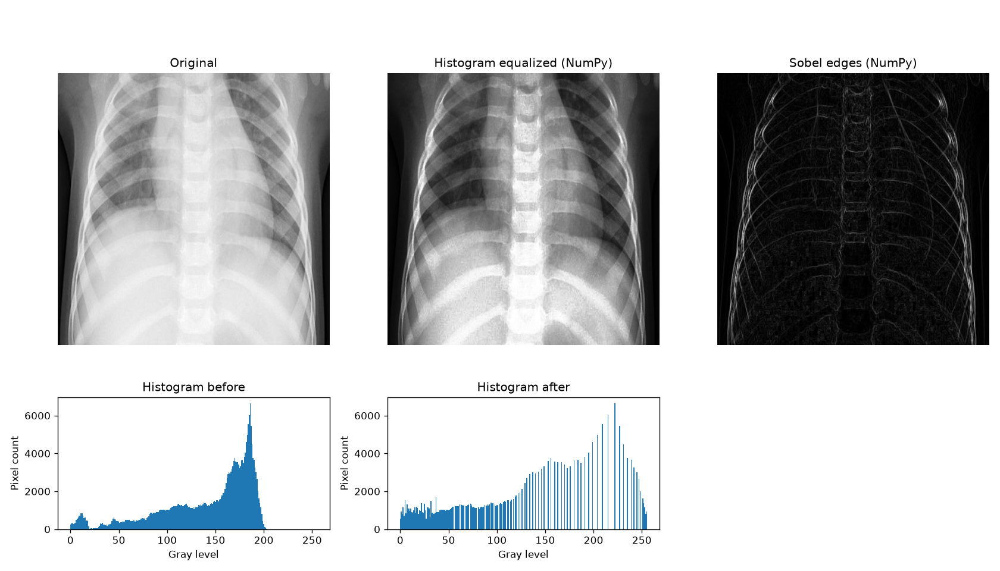

# Prediction of Chest Disease from X-Ray

[](https://github.com/ferhatolmez/PredictionOfChestDiseaseFromX-Ray/actions/workflows/tests.yml)

Classification of chest X-rays into **COVID-19, Normal, Pneumonia and Tuberculosis** with a pretrained CNN (MobileNetV2, transfer learning), plus two classic image-processing algorithms implemented **from scratch in NumPy**.

## Project structure

```
├── göğüs röntgeninden viral enfeksiyon tespiti.ipynb   # main notebook: data → preprocessing → model → evaluation
├── download_data.py          # downloads the Kaggle dataset and flattens it into data/<CLASS>/
├── from_scratch/             # NumPy-only algorithms
│   ├── histogram_equalization.py
│   ├── sobel.py
│   └── demo.py               # saves a comparison figure
├── tests/                    # pytest unit tests (checked against OpenCV)
├── docs/math_in_this_project.md   # the mathematics used in the code
├── requirements.txt / environment.yml
└── .github/workflows/tests.yml    # style check + tests on Linux and Windows
```

## Getting started

```bash
git clone https://github.com/ferhatolmez/PredictionOfChestDiseaseFromX-Ray.git
cd PredictionOfChestDiseaseFromX-Ray
```

Create an environment with **either** Anaconda **or** pip:

```bash
# Anaconda / Miniconda
conda env create -f environment.yml
conda activate chest-xray

# or: venv + pip
python -m venv .venv
source .venv/bin/activate          # Windows: .venv\Scripts\activate
pip install -r requirements.txt
```

## Dataset

[Chest X-Ray (Pneumonia, Covid-19, Tuberculosis)](https://www.kaggle.com/datasets/jtiptj/chest-xray-pneumoniacovid19tuberculosis) — 7,135 images in 4 classes. The images are not stored in this repository.

**Automatic download** (needs a Kaggle API token in `~/.kaggle/kaggle.json`):

```bash
pip install kaggle
python download_data.py
```

**Manual download:** download the archive from Kaggle and put the images into `data/COVID19/`, `data/NORMAL/`, `data/PNEUMONIA/` and `data/TUBERCULOSIS/`.

Then run the notebook:

```bash
jupyter notebook "göğüs röntgeninden viral enfeksiyon tespiti.ipynb"
```

## Method

1. **Preprocessing:** resize to 224×224, white balance per channel, normalisation to [0, 1].
2. **Split:** stratified **train / validation / test = 70 / 15 / 15** (`train_test_split` applied twice). The validation set is used for `EarlyStopping`, `ReduceLROnPlateau` and `ModelCheckpoint`; the test set is used **only once**, for the final report — this avoids data leakage.
3. **Model:** MobileNetV2 pretrained on ImageNet + `GlobalAveragePooling2D` → `Dense(256)` → `Dropout(0.5)` → `Dense(4, softmax)`. A `Rescaling` layer maps inputs to [-1, 1], the range MobileNetV2 was trained on.
4. **Training in two phases:** (1) frozen backbone, train only the head; (2) fine-tune the last 30 backbone layers with a 100× smaller learning rate. Light data augmentation (no horizontal flip, since chest anatomy is not left-right symmetric) and balanced class weights against class imbalance.

## Algorithms from scratch (NumPy)

| Module | What it does |
|---|---|
| `histogram_equalization.py` | Builds the histogram and CDF by hand and maps every gray level through the CDF to stretch contrast. |
| `sobel.py` | 2-D correlation with reflect-101 padding, Sobel Gx/Gy kernels, gradient magnitude and direction. |



Both are verified against OpenCV: histogram equalization matches `cv2.equalizeHist` exactly, and Gx/Gy match `cv2.Sobel(ksize=3)`.

```bash
pytest                                                   # run all unit tests
ruff check . && ruff format --check from_scratch tests   # PEP 8 style check
python -m from_scratch.demo data/PNEUMONIA/<image>.jpeg  # save the comparison figure
```

The style check and tests run automatically on **Ubuntu and Windows** with GitHub Actions on every push.

## Mathematics

[`docs/math_in_this_project.md`](docs/math_in_this_project.md) explains the linear algebra, probability, statistics and calculus behind the code (convolution as an inner product, gradient norm, CDF, softmax, chain rule / backpropagation) and links every concept to where it is used.
